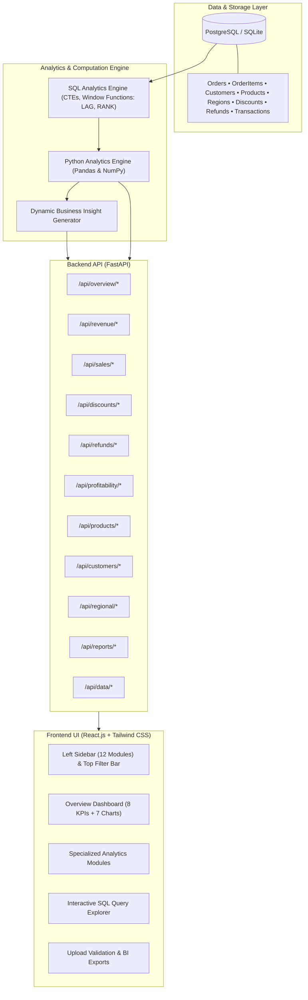

# RevenueGuard – Enterprise Revenue Analytics Platform

**RevenueGuard** is an enterprise-grade revenue intelligence and financial analytics platform designed to monitor, analyze, and optimize business financial performance. Built with **React.js**, **Tailwind CSS**, **Recharts**, **FastAPI**, **PostgreSQL / SQLite**, and **Pandas**, RevenueGuard transforms raw business transaction data into executive insights through SQL CTEs, window functions, and interactive Power BI-style dashboards.

---

## 1. System Architecture



---

## 2. Technology Stack

- **Frontend**: React.js 18, Tailwind CSS, Recharts, Lucide React icons, Vite 5
- **Backend**: Python 3.12, FastAPI, Uvicorn, Pydantic v2
- **Database & ORM**: PostgreSQL / SQLite (with WAL mode & foreign keys), SQLAlchemy 2.0
- **Data Analytics Engine**: Pandas, NumPy, OpenPyXL
- **Business Intelligence**: Power BI-ready Star-Schema datasets, multi-sheet Excel workbooks, dynamic CSV streaming

---

## 3. Core Modules & Navigation (12 Sections)

1. **Overview**: Executive dashboard with 8 real-time KPI cards, 7 analytical charts (Monthly Revenue Trend, Revenue vs Profit, Category Donut, Sales by Region, Top 10 Products, Discount vs Revenue, Category Margin Breakdown), Recent Transactions ledger, and dynamic Business Insights.
2. **Revenue Analytics**: Gross vs net bookings, period growth velocity (LAG window function), monthly/quarterly granularity, and product/regional attribution.
3. **Sales Performance**: Total orders, units fulfilled, Average Order Value (AOV), payment method splits (Wire, Credit Card, ACH, PayPal), and searchable transactions.
4. **Discount Analysis**: Promotional concessions, gross margin erosion rates, discount type evaluations, and high-discount transactions watchlist.
5. **Refund Analysis**: Post-sale returns, portfolio refund rate %, root cause categorization, and high-refund product defect alerts.
6. **Profitability Analysis**: Unit economics, Cost of Goods Sold (COGS), gross profit margins, and a 4-quadrant product profit matrix (Stars, Workhorses, Niche Opportunities, Underperformers).
7. **Product Insights**: Complete catalog ranking by net revenue, unit margins, discount dependencies, best-sellers, and low-performers.
8. **Customer Insights**: Enterprise, Mid-Market, SMB, and Direct Consumer segmentation, lifetime value, average account spend, and repeat purchase frequencies.
9. **Regional Analysis**: Territorial performance across North America, EMEA, APAC, and LATAM with margin yields and clawback rates.
10. **Reports & Exports**: 1-click CSV download, Multi-Sheet Excel BI workbook generation, Power BI live JSON feed, and executive performance briefs.
11. **Data Management**: CSV/Excel dataset upload, pre-flight validation (missing columns, duplicate primary keys, invalid records), Data Quality Score, ingestion history, 1-click 5,200 sample dataset generator, and Interactive SQL Query Runner.
12. **Settings**: Currency selection, fiscal year calendar configuration, profit margin threshold alert floors, and database connection diagnostics.

---

## 4. Database Schema

- `categories`: id, name, code, description
- `products`: id, category_id, sku, name, unit_price, unit_cost, target_margin, is_active
- `regions`: id, name, code, country, state, city
- `customers`: id, customer_code, name, email, segment, region_id, created_at
- `orders`: id, order_number, customer_id, region_id, order_date, status, payment_method, shipping_cost, totals
- `order_items`: id, order_id, product_id, quantity, unit_price, unit_cost, discount_amount, gross_revenue, net_revenue, cogs, profit
- `discounts`: id, order_id, order_item_id, discount_code, discount_type, discount_percentage, discount_amount, reason
- `refunds`: id, order_id, order_item_id, refund_date, refund_amount, refund_reason, status
- `transactions`: id, transaction_reference, order_id, transaction_type, amount, payment_method, status, created_at
- `data_uploads`: id, filename, rows_count, valid_rows, invalid_rows, duplicate_rows, status, upload_date, summary_notes

---

## 5. SQL Analytics Queries Implemented

- **Period-over-Period Growth**: Common Table Expressions with `LAG(net_revenue, 1) OVER (ORDER BY month_period)`
- **Product Rankings**: `RANK() OVER (ORDER BY net_revenue DESC)`
- **Category Profit Margins**: Multi-table joins between `orders`, `order_items`, `products`, `categories`, and `refunds` with conditional margin calculations
- **Territorial Aggregations**: Grouping by regional geographic dimensions with discount and clawback rates

---

## 6. How to Run Locally

### 1. Prerequisites
- Python 3.10+
- Node.js 18+

### 2. Backend Setup
```bash
# Create virtual environment
python3 -m venv venv
source venv/bin/activate

# Install dependencies
pip install fastapi uvicorn pydantic sqlalchemy pandas numpy openpyxl python-multipart python-dotenv psycopg2-binary

# Seed synthetic dataset (5,200 orders)
python3 -m backend.seed_data

# Start FastAPI server
uvicorn backend.main:app --host 127.0.0.1 --port 8000
```

### 3. Frontend Setup
```bash
cd frontend
npm install
npm run dev
```
Open [http://127.0.0.1:5173](http://127.0.0.1:5173) in your browser.

