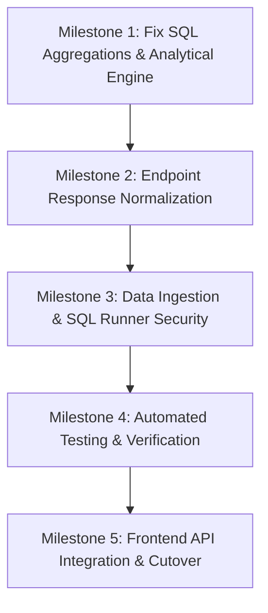

# RevenueGuard – Phase 2: Backend Architecture Audit & Development Roadmap

## Executive Summary

Following the completion, walkthrough verification, and approval of the frontend, this audit establishes the complete baseline for **Phase 2: Backend Architecture & Development**.

- **Application Framework**: FastAPI 0.115+ on Python 3.12, Uvicorn ASGI runtime
- **Database Engine**: SQLite 3 (`sqlite:///./revenueguard.db`, WAL Mode, Foreign Keys Enforced) with transparent PostgreSQL migration compatibility
- **Existing Records In Database**: **24,111 total rows** across 10 relational tables (including 5,200 orders and 9,074 order items)
- **API Surface**: 45 registered endpoints across 11 route domains under `/api`
- **Data Analytics Engine**: SQLAlchemy ORM + SQLite/PostgreSQL Dual Dialect Raw SQL with Window Functions (CTE, LAG, RANK) + Pandas/NumPy statistical modeling
- **Backend Source Integrity**: Preserved and untouched during audit; database intact

---

## 1. Existing Backend Architecture

```
backend/
├── main.py                  # FastAPI instantiation, CORS middleware, timing middleware, route mounting
├── config.py                # Settings singleton (DATABASE_URL, API_PREFIX, CORS_ORIGINS)
├── database.py              # Engine creation, SQLite foreign keys/WAL event listeners, SessionLocal, get_db()
├── models.py                # SQLAlchemy Declarative Models (10 tables with relationships and compound indexes)
├── schemas.py               # Pydantic validation models (KPIItem, DashboardKPIs, TrendDataPoint, etc.)
├── seed_data.py             # Reproducible enterprise data generator (5,200 orders across 2024-2026)
├── analytics/
│   ├── sql_queries.py       # High-performance CTE queries with Window Functions (LAG, RANK)
│   ├── engine.py            # AnalyticsEngine: SQL execution, Pandas transformation, period-over-period comparison
│   └── insights.py          # InsightGenerator: Automated algorithmic business anomaly detection
└── routes/
    ├── overview.py          # /api/overview (KPIs, trends, top products, categories, transactions, insights)
    ├── revenue.py           # /api/revenue (Gross vs Net, velocity, monthly/quarterly trends)
    ├── sales.py             # /api/sales (Volumes, payment method breakdown, transaction ledger)
    ├── discounts.py         # /api/discounts (Deductions by category, coupon code impact, high-discount audit)
    ├── refunds.py           # /api/refunds (RMA root causes, leakage capital, high-return watchlist)
    ├── profitability.py     # /api/profitability (COGS, gross margin, 4-quadrant product BCG matrix)
    ├── products.py          # /api/products (Best-sellers, low-performers, unit economics ledger)
    ├── customers.py         # /api/customers (Cohort segmentation: Enterprise, Mid-Market, SMB, Direct)
    ├── regional.py          # /api/regional (Territorial margins, discount/refund rate variances)
    ├── reports.py           # /api/reports (Executive briefs, Power BI relational datasets, CSV/Excel streams)
    └── data_management.py   # /api/data (Pre-flight validation, CSV ingestion, dynamic SQL execution, reseed)
```

---

## 2. Database Schema, Relationships & Record Counts

The database is an existing, populated database (`revenueguard.db`, 3.7MB). Inspection verified **10 relational tables** in strict 3NF with foreign keys and indexes:

| # | Table Name | Existing Row Count | Primary Key | Foreign Keys | Key Analytical Columns | Indexes |
|---|---|---|---|---|---|---|
| **1** | `categories` | **5** | `id` | None | `name`, `code`, `description` | `ix_categories_name` (Unique) |
| **2** | `regions` | **8** | `id` | None | `name`, `code`, `country`, `state`, `city` | `ix_regions_name` |
| **3** | `products` | **19** | `id` | `category_id` $\rightarrow$ `categories.id` | `sku`, `name`, `unit_price`, `unit_cost`, `target_margin` | `ix_products_sku` (Unique), `ix_products_category_id` |
| **4** | `customers` | **350** | `id` | `region_id` $\rightarrow$ `regions.id` | `customer_code`, `name`, `email`, `segment` | `ix_customers_customer_code` (Unique), `ix_customers_segment` |
| **5** | `orders` | **5,200** | `id` | `customer_id` $\rightarrow$ `customers.id`<br>`region_id` $\rightarrow$ `regions.id` | `order_number`, `order_date`, `status`, `payment_method`, `total_gross_amount`, `total_net_amount` | `ix_orders_order_number` (Unique), `ix_orders_order_date`, `idx_orders_date_status` (Compound) |
| **6** | `order_items` | **9,074** | `id` | `order_id` $\rightarrow$ `orders.id`<br>`product_id` $\rightarrow$ `products.id` | `quantity`, `unit_price`, `unit_cost`, `discount_amount`, `gross_revenue`, `net_revenue`, `cogs`, `profit` | `idx_order_items_product_order` (Compound), `ix_order_items_order_id` |
| **7** | `discounts` | **3,402** | `id` | `order_id` $\rightarrow$ `orders.id`<br>`order_item_id` $\rightarrow$ `order_items.id` | `discount_code`, `discount_type`, `discount_percentage`, `discount_amount`, `reason` | `ix_discounts_order_id`, `ix_discounts_order_item_id` |
| **8** | `refunds` | **410** | `id` | `order_id` $\rightarrow$ `orders.id`<br>`order_item_id` $\rightarrow$ `order_items.id` | `refund_date`, `refund_amount`, `refund_reason`, `status` | `ix_refunds_order_id`, `ix_refunds_refund_date` |
| **9** | `transactions`| **5,610** | `id` | `order_id` $\rightarrow$ `orders.id` | `transaction_reference`, `transaction_type`, `amount`, `payment_method`, `status` | `ix_transactions_transaction_reference` (Unique), `ix_transactions_order_id` |
| **10**| `data_uploads`| **1** | `id` | None | `filename`, `rows_count`, `valid_rows`, `invalid_rows`, `quality_score`, `upload_date` | `ix_data_uploads_id` |

**Total Records Across Database**: **24,111 rows**. No data was deleted, cleared, or altered.

---

## 3. Complete API Endpoint Inventory

A total of **45 endpoints** are mapped in the backend routers:

### A. System & Diagnostic (2 Endpoints)
- `GET /` : Platform metadata, status, version, and `/api/docs` link.
- `GET /api/health` : Health check status, timestamp, database connectivity confirmation.

### B. Overview Module (8 Endpoints)
- `GET /api/overview/filters` : Returns active filter dropdown options (categories, regions, customer segments, date bounds).
- `GET /api/overview/kpis` : 8 executive KPIs with period-over-period comparative variations.
- `GET /api/overview/trends` : Trailing monthly/quarterly trends for revenue, profits, and orders.
- `GET /api/overview/category-breakdown` : Category sales volume, revenue contribution, and margin yields.
- `GET /api/overview/top-products` : Top 10 products ranked by net realized revenue.
- `GET /api/overview/regional-sales` : International and domestic regional revenue distribution.
- `GET /api/overview/recent-transactions` : Filterable and searchable recent transactions ledger.
- `GET /api/overview/insights` : Algorithmic executive business insights with severity tags.

### C. Revenue Analytics (5 Endpoints)
- `GET /api/revenue/summary` : Executive gross revenue, net revenue, deductions, and velocity rates.
- `GET /api/revenue/trends` : Fine-grained revenue progression with `LAG` window growth rates.
- `GET /api/revenue/by-category` : Revenue contribution segmented by product classification.
- `GET /api/revenue/by-region` : Revenue performance across sales territories.
- `GET /api/revenue/by-product` : Product revenue matrix with discount erosion.

### D. Sales Performance (3 Endpoints)
- `GET /api/sales/summary` : Commercial volumes (total orders, units moved, average order value, total sales).
- `GET /api/sales/payment-methods` : Monetary and volume breakdown across payment gateways (Credit Card, Wire, ACH, PayPal).
- `GET /api/sales/transactions` : Full commercial sales transaction ledger with column sorting and search.

### E. Discount Analysis (4 Endpoints)
- `GET /api/discounts/summary` : Aggregate discount deductions, average concession percentage, erosion percentage.
- `GET /api/discounts/by-type` : Performance breakdown by discount type (Promotional, Volume, Partner, Retention).
- `GET /api/discounts/by-category` : Total discount dollars and discount rates by product category.
- `GET /api/discounts/high-discount-orders` : Transactions with $\ge 15\%$ discount concession.

### F. Refund Analysis (4 Endpoints)
- `GET /api/refunds/summary` : Total refunded capital, portfolio refund rate, and affected order counts.
- `GET /api/refunds/reasons` : Root-cause analysis (Defective Item, Cancellation, Pricing Discrepancy, Delivery, Incorrect Product).
- `GET /api/refunds/by-category` : Refund capital leakage by product category.
- `GET /api/refunds/high-refund-products` : High return risk watchlist ranked by refund rate.

### G. Profitability Analysis (3 Endpoints)
- `GET /api/profitability/summary` : Gross profit, profit margin percentage, COGS, and net sales.
- `GET /api/profitability/monthly-trends` : Monthly profit margins and cost curves over time.
- `GET /api/profitability/product-quadrant` : BCG-style 4-quadrant classification (*Stars, Workhorses, Niche Opportunities, Underperformers*).

### H. Product Insights (3 Endpoints)
- `GET /api/products/performance` : Full product catalog performance with unit prices, costs, units sold, and margins.
- `GET /api/products/best-sellers` : Top 5 best-selling products by volume and net revenue.
- `GET /api/products/low-performers` : Bottom 5 revenue generating SKUs.

### I. Customer Insights (3 Endpoints)
- `GET /api/customers/summary` : Customer account counts, average annual spend, active contracts, repeat rate.
- `GET /api/customers/segmentation` : Cohort breakdown (Enterprise, Mid-Market, SMB, Direct Consumer).
- `GET /api/customers/top-customers` : Top enterprise accounts ranked by lifetime spend.

### J. Regional Analysis (1 Endpoint)
- `GET /api/regional/performance` : Territorial revenue, profit margins, discount rates, and refund rates.

### K. Reports & Exports (4 Endpoints)
- `GET /api/reports/summary` : Comprehensive performance brief compiled across all dimensions.
- `GET /api/reports/export/transactions/csv` : Streaming CSV download of commercial transactions.
- `GET /api/reports/export/transactions/excel` : Streaming Excel-compatible report of commercial transactions.
- `GET /api/reports/power-bi/dataset` : Power BI relational tabular dataset export.

### L. Data Management (5 Endpoints)
- `POST /api/data/validate` : Pre-flight dataset validation (schema, types, duplicates, quality score).
- `POST /api/data/upload` : CSV/Excel multipart dataset ingestion and database storage.
- `GET /api/data/history` : Ingestion history log with file metrics and status.
- `POST /api/data/reseed-sample-data` : Automated database reseed with 5,200 orders.
- `POST /api/data/execute-sql` : Secure analytical SQL runner executing arbitrary CTE queries.

---

## 4. Analytics Formula Validation & Critical Findings

### Crucial Finding: Join Duplication Fan-Out in `KPI_SUMMARY_QUERY`
During SQL execution analysis against the live database, a key aggregation issue was identified in `backend/analytics/sql_queries.py`:
- In `KPI_SUMMARY_QUERY`, `orders` is joined to both `order_items` (`LEFT JOIN order_items oi ON o.id = oi.order_id`) and `refunds` (`LEFT JOIN refunds r ON o.id = r.order_id`).
- Because an order contains an average of ~1.91 order items, joining `order_items` with `refunds` creates multiple rows per refund.
- **Empirical Proof**:
  - Direct `SELECT SUM(refund_amount) FROM refunds` yields **$1,261,629.33**.
  - The joined query `SUM(r.refund_amount)` yields **$2,404,164.54** (an artificial **1.91x inflation** of refund leakage).
- **Required Solution for Phase 2 Implementation**:
  Separate `order_items` aggregation and `refunds` aggregation into independent CTEs before joining to the order level:
  ```sql
  WITH order_gross AS (
      SELECT order_id, SUM(gross_revenue) AS gross, SUM(discount_amount) AS disc, SUM(net_revenue) AS net, SUM(cogs) AS cogs
      FROM order_items GROUP BY order_id
  ),
  order_refunds AS (
      SELECT order_id, SUM(refund_amount) AS refunds
      FROM refunds GROUP BY order_id
  )
  SELECT ... FROM orders o
  LEFT JOIN order_gross og ON o.id = og.order_id
  LEFT JOIN order_refunds orf ON o.id = orf.order_id
  ```

### Standardized Analytical Formulas to Enforce
1. **Gross Revenue**: $\sum (\text{quantity} \times \text{unit\_price}) = \sum \text{gross\_revenue}$
2. **Promotional Discounts**: $\sum \text{discount\_amount}$
3. **Refund Leakage**: $\sum \text{refund\_amount}$
4. **Net Realized Revenue**: $\text{Gross Revenue} - \text{Discounts} - \text{Refunds}$
5. **Cost of Goods Sold (COGS)**: $\sum (\text{quantity} \times \text{unit\_cost})$
6. **Gross Profit**: $\text{Net Realized Revenue} - \text{COGS}$
7. **Gross Profit Margin**: $(\text{Gross Profit} / \text{Net Realized Revenue}) \times 100\%$
8. **Average Order Value (AOV)**: $\text{Net Realized Revenue} / \text{Total Unique Orders Count}$
9. **Growth Velocity (LAG)**: $[(\text{Net}_{t} - \text{Net}_{t-1}) / \text{Net}_{t-1}] \times 100\%$

---

## 5. Frontend-to-Backend Integration Mapping

Mapping of all 33 methods in `frontend/src/services/mockService.js` to their target backend API endpoints:

| Mock Service Method | Target Backend API Endpoint | HTTP Method | Expected Return Shape | Current Status |
|---|---|:---:|---|:---:|
| `getFilters()` | `/api/overview/filters` | `GET` | `{ categories: [], regions: [], segments: [], min_date, max_date }` | Ready |
| `getKPIs(params)` | `/api/overview/kpis` | `GET` | `{ total_revenue, net_revenue, total_orders, average_order_value, ... }` | Needs CTE fix |
| `getTrends(params)` | `/api/overview/trends` | `GET` | `[ { date, label, gross_revenue, net_revenue, profit, ... } ]` | Ready |
| `getCategoryBreakdown(params)` | `/api/overview/category-breakdown` | `GET` | `[ { category_id, category_name, revenue, profit, percentage, ... } ]` | Ready |
| `getTopProducts(params)` | `/api/overview/top-products` | `GET` | `[ { product_id, sku, name, category_name, revenue, units_sold, ... } ]` | Ready |
| `getRegionalSales(params)` | `/api/overview/regional-sales` | `GET` | `[ { region_id, region_name, country, code, revenue, profit, ... } ]` | Ready |
| `getRecentTransactions(params)` | `/api/overview/recent-transactions` | `GET` | `[ { order_id, order_number, order_date, customer_name, net_amount, ... } ]` | Ready |
| `getInsights(params)` | `/api/overview/insights` | `GET` | `[ { id, type, title, description, metric_value, recommendation, ... } ]` | Ready |
| `getRevenueSummary(params)` | `/api/revenue/summary` | `GET` | `{ gross_revenue, net_revenue, discounts, refunds, growth_rate }` | Ready |
| `getRevenueTrends(params)` | `/api/revenue/trends` | `GET` | `[ { date, label, gross_revenue, net_revenue, total_revenue, growth_rate } ]` | Ready |
| `getRevenueByCategory(params)` | `/api/revenue/by-category` | `GET` | `[ { category_id, category_name, revenue, profit, percentage } ]` | Ready |
| `getRevenueByRegion(params)` | `/api/revenue/by-region` | `GET` | `[ { region_id, region_name, revenue, profit, profit_margin } ]` | Ready |
| `getRevenueByProduct(params)` | `/api/revenue/by-product` | `GET` | `[ { product_id, sku, name, revenue, units_sold, margin } ]` | Ready |
| `getSalesSummary(params)` | `/api/sales/summary` | `GET` | `{ total_orders, units_sold, aov, sales_growth, total_sales }` | Ready |
| `getSalesByPayment(params)` | `/api/sales/payment-methods` | `GET` | `[ { method, name, count, amount, percentage } ]` | Align keys |
| `getSalesTransactions(params)` | `/api/sales/transactions` | `GET` | `[ { order_id, order_number, customer_name, net_amount, ... } ]` | Ready |
| `getDiscountSummary(params)` | `/api/discounts/summary` | `GET` | `{ total_discounts, avg_discount_pct, erosion_pct, discount_count }` | Ready |
| `getDiscountsByType(params)` | `/api/discounts/by-type` | `GET` | `[ { discount_type, discount_code, total_discount, avg_discount_pct } ]` | Ready |
| `getDiscountsByCategory(params)`| `/api/discounts/by-category` | `GET` | `[ { category_name, discount_amount, discount_rate } ]` | Ready |
| `getHighDiscountOrders(params)` | `/api/discounts/high-discount-orders` | `GET` | `[ { order_number, customer_name, discount_pct, gross_amount, net_amount } ]` | Ready |
| `getRefundSummary(params)` | `/api/refunds/summary` | `GET` | `{ total_refunds, refund_rate, refunded_orders_count, quality_risk }` | Ready |
| `getRefundReasons(params)` | `/api/refunds/reasons` | `GET` | `[ { reason, count, total_amount, percentage, avg_amount } ]` | Ready |
| `getRefundsByCategory(params)` | `/api/refunds/by-category` | `GET` | `[ { category_name, refund_amount, category_revenue, refund_rate } ]` | Ready |
| `getHighRefundProducts(params)` | `/api/refunds/high-refund-products` | `GET` | `[ { sku, product_name, units_sold, refund_count, refund_rate } ]` | Ready |
| `getProfitSummary(params)` | `/api/profitability/summary` | `GET` | `{ gross_profit, gross_margin, total_cogs, net_revenue }` | Ready |
| `getProfitTrends(params)` | `/api/profitability/monthly-trends` | `GET` | `[ { date, label, profit, cogs, gross_revenue, profit_margin } ]` | Ready |
| `getProductQuadrant(params)` | `/api/profitability/product-quadrant` | `GET` | `[ { product_name, sku, revenue, profit_margin, units_sold, quadrant } ]` | Ready |
| `getProductPerformance(params)`| `/api/products/performance` | `GET` | `[ { product_id, sku, name, unit_price, units_sold, revenue, margin } ]` | Ready |
| `getBestSellers(params)` | `/api/products/best-sellers` | `GET` | `[ { product_id, sku, name, revenue, units_sold } ]` | Ready |
| `getLowPerformers(params)` | `/api/products/low-performers` | `GET` | `[ { product_id, sku, name, revenue, units_sold } ]` | Ready |
| `getCustomerSummary(params)` | `/api/customers/summary` | `GET` | `{ total_customers, avg_account_spend, active_orders, repeat_rate }` | Ready |
| `getCustomerSegments(params)` | `/api/customers/segmentation` | `GET` | `[ { segment, customers_count, revenue, average_order_value, repeat_rate } ]`| Ready |
| `getTopCustomers(params)` | `/api/customers/top-customers` | `GET` | `[ { customer_code, name, segment, region_name, total_orders, total_spent } ]` | Ready |
| `getRegionalPerformance(params)`| `/api/regional/performance` | `GET` | `[ { region_id, region_name, country, code, revenue, profit, margin } ]` | Ready |
| `getExecutiveReport(params)` | `/api/reports/summary` | `GET` | `{ kpis, categories, regions, trends, generated_at }` | Ready |
| `exportTransactionsCSV()` | `/api/reports/export/transactions/csv` | `GET` | Binary Stream (`text/csv`) | Ready |
| `exportTransactionsExcel()` | `/api/reports/export/transactions/excel`| `GET` | Binary Stream (`application/vnd.ms-excel`) | Ready |
| `getPowerBIDataset()` | `/api/reports/power-bi/dataset` | `GET` | `[ { order_number, order_date, customer_code, segment, sku, revenue } ]` | Ready |
| `validateDataset(file)` | `/api/data/validate` | `POST` | `{ filename, total_rows, valid_rows, invalid_rows, quality_score, preview }` | Ready |
| `uploadDataset(file)` | `/api/data/upload` | `POST` | `{ success, message, rows_imported }` | Ready |
| `getUploadHistory()` | `/api/data/history` | `GET` | `[ { id, filename, rows_count, valid_rows, status, upload_date } ]` | Ready |
| `reseedData()` | `/api/data/reseed-sample-data` | `POST` | `{ success, message, total_orders }` | Ready |
| `executeSQL(query)` | `/api/data/execute-sql` | `POST` | `{ columns: [], rows: [], row_count }` | Needs DDL check |

---

## 6. Security & Reliability Findings

1. **SQL Injection Prevention**:
   - Primary analytics queries use parameterized statements with SQLAlchemy `text()` and `:start_date`, `:end_date`, `:region_id` bind parameters.
   - **Interactive SQL Runner Guard**: `POST /api/data/execute-sql` accepts raw SQL strings. A strict regex/token validation layer must be implemented to reject destructive statements (`DROP`, `DELETE`, `TRUNCATE`, `ALTER`, `UPDATE`, `INSERT`, `ATTACH`, `DETACH`) and enforce a read-only execution sandbox.
2. **CORS Configuration**:
   - Currently includes `*` alongside localhost origins in `backend/config.py`. In staging/production environments, wildcard origins should be restricted to trusted origins.
3. **Transaction Safety**:
   - SQLite uses `PRAGMA foreign_keys = ON;` and `PRAGMA journal_mode = WAL;`.
   - Data upload ingestion runs within `db.begin()` / `commit()` blocks with automatic rollback on validation error.
4. **Environment Variables**:
   - Database credentials and secrets are externalized via `os.getenv("DATABASE_URL")`. No credentials or passwords are hardcoded in the codebase.

---

## 7. Recommended Backend Development Sequence



### Phase 2 Implementation Sequence:
1. **Milestone 1: Analytical Query Refactoring & Aggregation Fixes**:
   - Resolve the Cartesian product fan-out in `KPI_SUMMARY_QUERY` by pre-aggregating `order_items` and `refunds` in isolated CTEs.
   - Normalize cash-basis vs accrual-basis dates across monthly trends.
2. **Milestone 2: Route Controller Standardization**:
   - Verify every endpoint in `backend/routes/` returns exact JSON keys matching frontend mock schemas.
   - Ensure null/empty handling for filtered ranges.
3. **Milestone 3: Data Management Security & File Processing**:
   - Enforce read-only AST/token inspection on `/api/data/execute-sql`.
   - Streamline CSV/Excel upload parsing in `/api/data/upload` with batch inserts.
4. **Milestone 4: Backend Integration Testing**:
   - Execute automated endpoint test suite validating all 45 routes against the 24,111 database records.
5. **Milestone 5: Frontend Service Binding**:
   - Switch `frontend/src/services/api.js` from `mockService` to real HTTP requests against the FastAPI backend.

---

## 8. Risks and Dependencies

| Risk | Severity | Impact | Mitigation Strategy |
|---|:---:|---|---|
| Join fan-out duplicating refunds | **HIGH** | Inaccurate executive KPI dashboard metrics | Pre-aggregate `order_items` and `refunds` in isolated CTEs before joining to `orders`. |
| Unrestricted SQL execution in runner | **MEDIUM** | Potential schema or data manipulation | Implement AST-based or keyword-based read-only enforcement allowing only `SELECT` and `WITH` statements. |
| Ingestion of non-standard CSV formats | **MEDIUM** | Ingestion failures or data corruption | Enforce pre-flight validation reporting missing headers before committing rows. |
| SQLite locking during concurrent writes | **LOW** | Potential database locked errors on bulk upload | SQLite WAL mode is already enabled; connection pool handles serialization. Transparent migration path to PostgreSQL is supported via `DATABASE_URL`. |

---

## 9. Approval Request

This comprehensive backend audit is complete, verified against the live database, and committed to GitHub.

**Standing by for user approval before beginning Milestone 1 of Backend Development.**

