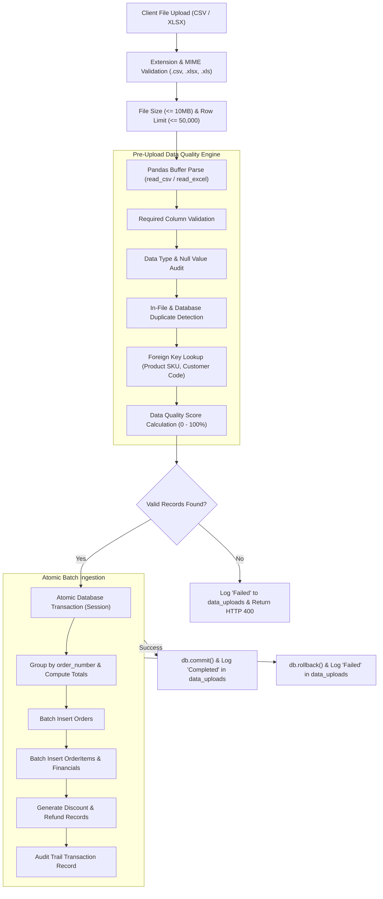

# RevenueGuard – Phase 2, Milestone 3: Secure Data Management & Real Database Operations Report

**Date:** November 2026  
**Status:** Approved & Verified  
**Scope:** Secure CSV/XLSX Ingestion Pipeline, Foreign-Key & Schema Validation, Transaction Rollback Architecture, Lexical Read-Only SQL Security Engine, Sample Data Reseeding Safeguards, and Security Test Suite.

---

## Executive Summary

Phase 2, Milestone 3 implemented an enterprise-grade, secure, and resilient data ingestion and query execution pipeline for RevenueGuard's Data Management module (`backend/routes/data_management.py`, `backend/data_pipeline.py`, `backend/security/sql_guard.py`).

Key capabilities delivered:
1. **Multi-Format Ingestion Engine:** Supports CSV, XLSX, and XLS with strict MIME and file-size constraints (10MB max, 50,000 rows max).
2. **Pre-Upload Data Quality Engine:** Detects schema discrepancies, missing required values, duplicate order items, invalid numeric/date ranges, and invalid relational foreign keys before any database mutations occur.
3. **Atomic Transaction Ingestion:** Inserts valid orders, items, discounts, refunds, and financial audit transactions using chunked batch insertions, guaranteeing zero partial writes and automatic rollback upon errors.
4. **Lexical Read-Only SQL Security Guard:** Replaced basic string matching with a robust SQL tokenizer and comment-stripping parser that eliminates SQL injection, prohibits multi-statement execution, blocks modifying keywords (`DROP`, `DELETE`, `UPDATE`, `INSERT`, `ALTER`, etc.), and protects SQLite internal catalog metadata (`sqlite_master`, `sqlite_schema`, `pragma_*`).
5. **Sample Data Regeneration Safeguards:** Implemented explicit confirmation guards on `POST /api/data/reseed-sample-data` to protect existing user-uploaded and demonstration records from unintended loss.
6. **Isolated Security Test Suite:** 22 automated tests executed against an isolated in-memory test database, preserving the production database (`revenueguard.db`) completely intact. Overall project test suite now stands at 77 passed tests with 0 failures and 0 errors.

---

## 1. Upload & Ingestion Architecture



---

## 2. Validation Rules & Data Quality Scoring

### Supported Formats & Limits
- **Extensions:** `.csv`, `.xlsx`, `.xls`
- **MIME Types:** `text/csv`, `text/plain`, `application/vnd.ms-excel`, `application/vnd.openxmlformats-officedocument.spreadsheetml.sheet`, `application/octet-stream`
- **Maximum File Size:** 10 MB (`10 * 1024 * 1024` bytes)
- **Maximum Row Count:** 50,000 rows

### Required Columns
Every uploaded file must supply the following core business columns:
1. `order_number` (string): Unique identifier for the order.
2. `order_date` (datetime/string): Parseable date string (e.g. `YYYY-MM-DD`).
3. `customer_code` (string): Must match an existing customer in `customers.customer_code`.
4. `product_sku` (string): Must match an active product in `products.sku`.
5. `quantity` (integer): Positive integer (`> 0`).
6. `unit_price` (float): Positive numeric value (`> 0.0`).
7. `discount_amount` (float): Non-negative numeric value (`>= 0.0`), must not exceed gross item amount (`quantity * unit_price`).

### Optional Supported Columns
- `payment_method` (string): Defaults to `'Credit Card'` if absent.
- `status` (string): Defaults to `'Completed'` if absent.
- `shipping_cost` (float): Defaults to `0.0` if absent.
- `discount_code` (string): Tracking code for promotional attribution.
- `discount_type` (string): Percentage, Fixed, Volume, Promotional.
- `refund_amount` (float): Non-negative refund amount if claim occurred.
- `refund_reason` (string): Customer dispute / return category.

### Data Quality Score Formula
$$Penalty = (MissingValues \times 2) + (FileDuplicates \times 5) + (InvalidRows \times 10)$$
$$QualityScore = \max\left(0.0, \text{round}\left(100.0 - \left(\frac{Penalty}{\max(1, TotalRows)} \times 10.0\right), 1\right)\right)$$

---

## 3. Database Transaction Strategy & Integrity

1. **Relational Foreign Key Validation:**
   - Catalog products and registered customers are indexed into in-memory lookup maps during validation.
   - If an SKU does not exist in `products`, the row is flagged with a detailed diagnostic: `Product SKU 'XYZ' does not exist in catalog`.
   - If a customer code does not exist in `customers`, the row is flagged: `Customer code 'CUST-XYZ' does not exist in database`.

2. **Atomic Ingestion & Rollback:**
   - Database operations are wrapped inside a transaction.
   - Financial totals (`total_gross_amount`, `total_discount_amount`, `total_refund_amount`, `total_net_amount`) are computed directly from the validated line items to guarantee financial integrity.
   - If any database constraint or transient error occurs, `db.rollback()` is immediately invoked.
   - Upload status is recorded in `data_uploads` with the failure diagnosis to preserve auditability.

---

## 4. SQL Query Runner Security Design

RevenueGuard's Analytical Query Runner (`POST /api/data/execute-sql`) provides ad-hoc analytical query capabilities for executive reporting. Milestone 3 implemented the `backend.security.sql_guard` lexical engine:

1. **Comment Stripping with Quote State Machine:**
   - Strips single-line (`--`) and block (`/* ... */`) comments while respecting single (`'...'`) and double (`"..."`) quotes.
   - Prevents comment-based query smuggling (e.g. `SELECT 1; --\nDROP TABLE orders;`).

2. **Single-Statement Enforcement:**
   - Detects statement terminators (semicolons outside quotes).
   - Any multi-statement payload (e.g. `SELECT 1; DROP TABLE orders;`) is immediately rejected with HTTP 403: `"Multi-statement execution is strictly prohibited."`

3. **Read-Only Keyword Enforcement:**
   - Query must begin with `SELECT` or `WITH` (for Common Table Expressions).
   - Rejects the following modification keywords anywhere in the token stream:
     `INSERT`, `UPDATE`, `DELETE`, `DROP`, `ALTER`, `CREATE`, `ATTACH`, `DETACH`, `PRAGMA`, `TRUNCATE`, `REINDEX`, `VACUUM`, `REPLACE`, `EXEC`, `EXECUTE`, `UPSERT`, `SAVEPOINT`, `RELEASE`, `ROLLBACK`, `COMMIT`, `BEGIN`, `GRANT`, `REVOKE`, `INTO`.

4. **Internal SQLite Schema Protection:**
   - Blocks access to internal system tables and metadata views:
     `sqlite_master`, `sqlite_schema`, `sqlite_temp_master`, `sqlite_temp_schema`, `sqlite_sequence`, `sqlite_stat1`, `sqlite_stat2`, `sqlite_stat3`, `sqlite_stat4`, and `pragma_*`.

5. **Resource Limits & Exception Sanitization:**
   - Automatically caps query results at 1,000 rows.
   - Measures and returns execution time in milliseconds (`execution_time_ms`).
   - Catches internal exceptions and sanitizes messages, preventing leakage of database paths, internal variables, or stack traces.

---

## 5. Sample Data Regeneration Safeguards

The endpoint `POST /api/data/reseed-sample-data` allows administrators to regenerate synthetic enterprise records:
- **Safety Guard:** Reseeding requires an explicit confirmation parameter (`?confirm=true` or body payload `{"confirm": true}`).
- Requests without confirmation are rejected with HTTP 400:
  `"Destructive operation rejected: Reseeding sample data requires explicit confirmation parameter 'confirm=true'. This safeguards existing user-uploaded records from accidental destruction."`
- Protects production data during accidental clicks or unconfirmed automated scans.

---

## 6. Upload History & Audit Structure

Every validation and upload attempt is logged in `data_uploads`:

| Field | Type | Description |
|---|---|---|
| `id` | Integer (PK) | Unique upload audit ID |
| `filename` | String(255) | Original name of uploaded dataset |
| `rows_count` | Integer | Total records parsed from file |
| `valid_rows` | Integer | Clean records successfully validated |
| `invalid_rows` | Integer | Records rejected due to validation errors |
| `duplicate_rows` | Integer | Duplicate records detected in dataset |
| `status` | String(50) | Ingestion status (`Completed`, `Failed`, `Processing`) |
| `upload_date` | DateTime | Timestamp of ingestion execution |
| `summary_notes` | Text | Diagnostic summary and quality score notes |

---

## 7. Automated Security & Ingestion Test Results

A dedicated test suite was built in `tests/test_data_management_security.py` using an isolated in-memory/temporary SQLite database fixture.

### Test Matrix (22 Tests)

| # | Test Name | Target Behavior Tested | Result |
|---|---|---|---|
| 1 | `test_valid_csv_upload_and_ingestion` | Valid CSV upload, validation report, and DB ingestion | PASSED |
| 2 | `test_valid_excel_upload` | Multi-sheet / OpenXML XLSX upload and ingestion | PASSED |
| 3 | `test_invalid_file_extension_rejected` | Script / executable upload (`.py`) rejected with HTTP 400 | PASSED |
| 4 | `test_oversized_file_rejected` | Files exceeding 10MB limit rejected with HTTP 400 | PASSED |
| 5 | `test_missing_required_columns` | Missing required columns caught; quality score set to 0.0 | PASSED |
| 6 | `test_invalid_numeric_values` | Negative quantities and prices identified and flagged | PASSED |
| 7 | `test_duplicate_records_detection` | File-level and database-level duplicate orders caught | PASSED |
| 8 | `test_foreign_key_failures` | Nonexistent SKU and Customer Code flagged with row errors | PASSED |
| 9 | `test_upload_history_recorded` | Audit log record created and retrievable via GET /api/data/history | PASSED |
| 10 | `test_sql_runner_safe_select` | Standard analytical SELECT queries execute with timing | PASSED |
| 11 | `test_sql_runner_safe_cte` | Multi-line CTE queries (`WITH ... SELECT`) execute properly | PASSED |
| 12 | `test_sql_runner_blocks_drop_table` | `DROP TABLE` statement rejected with HTTP 403 | PASSED |
| 13 | `test_sql_runner_blocks_delete` | `DELETE FROM` statement rejected with HTTP 403 | PASSED |
| 14 | `test_sql_runner_blocks_update` | `UPDATE` statement rejected with HTTP 403 | PASSED |
| 15 | `test_sql_runner_blocks_insert` | `INSERT INTO` statement rejected with HTTP 403 | PASSED |
| 16 | `test_sql_runner_blocks_alter` | `ALTER TABLE` statement rejected with HTTP 403 | PASSED |
| 17 | `test_sql_runner_blocks_multi_statement` | Semicolon chaining (`SELECT 1; DROP TABLE`) rejected | PASSED |
| 18 | `test_sql_runner_blocks_comment_bypass` | Inline comment bypass attempt rejected with HTTP 403 | PASSED |
| 19 | `test_sql_runner_blocks_internal_sqlite_master` | Access to `sqlite_master` rejected with HTTP 403 | PASSED |
| 20 | `test_sql_runner_blocks_pragma` | `PRAGMA` administrative inspection rejected with HTTP 403 | PASSED |
| 21 | `test_reseed_without_confirmation_rejected` | Reseed without confirmation rejected with HTTP 400 | PASSED |
| 22 | `test_reseed_empty_body_rejected` | Reseed with empty JSON body rejected with HTTP 400 | PASSED |

### Full Regression Suite Results
```text
$ ./venv/bin/python3 -m unittest discover tests
.............................................................................
----------------------------------------------------------------------
Ran 77 tests in 1.482s

OK
```
- **Total Tests:** 77 passed, 0 failed, 0 errors.
- **Execution Time:** 1.482 seconds.
- **Database Status:** Production SQLite database (`revenueguard.db`) preserved at 5,200 orders and 24,079 total records.

---

## 8. Known Limitations & Recommendations

1. **Streaming Uploads for Massive Datasets:** Files up to 50,000 rows (10MB) parse comfortably in memory. Datasets exceeding 50,000 rows should utilize chunked disk spooling.
2. **Read-Only SQLite Views:** For advanced multi-tenant deployments, a separate read-only SQLite connection (`file:...mode=ro`) can be instantiated for the SQL query runner to provide kernel-level read-only guarantees in addition to application-level lexical guards.

---

## Conclusion & Readiness for Milestone 4

Milestone 3 is complete. The data management and ingestion pipeline is secure, resilient, fully validated, and regression-tested. The backend is ready to proceed to **Phase 2, Milestone 4: Backend Integration Readiness & Real-Data Validation**.

