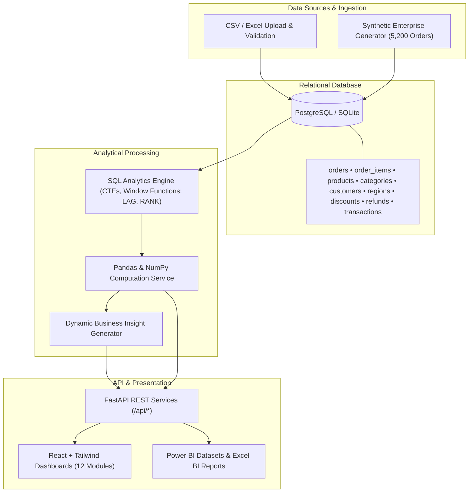
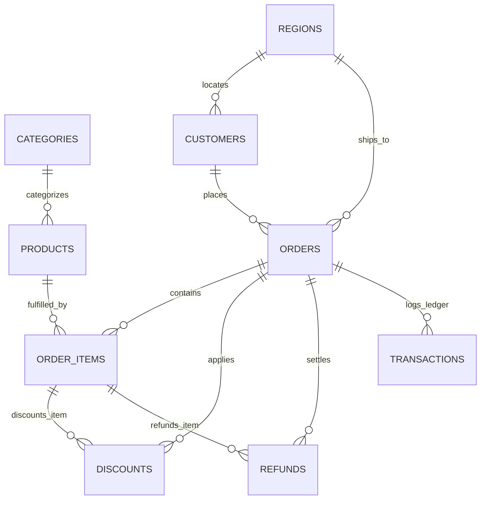

# RevenueGuard – Enterprise Revenue Analytics Platform
## System Architecture, Implementation & Verification Report

### Executive Summary

**RevenueGuard** has been architected and built as a full-stack, enterprise-grade Revenue Intelligence Platform designed to monitor, analyze, and optimize corporate financial performance. The platform transforms raw commercial transactional records into executive clarity through SQL CTEs, window functions, a Python-driven statistical analytics engine (Pandas & NumPy), and an interactive, Power BI-inspired web application.

---

### 1. Technology Stack & Component Architecture

| Layer | Technologies | Role & Implementation |
|---|---|---|
| **Frontend UI/UX** | React.js 18, Tailwind CSS, Recharts, Lucide Icons, Vite 5 | 12 dedicated analytical modules, warm off-white palette (`#FAF9F6`), dark sidebar (`#231F1D`), neutral borders (`#EAE6E2`), muted bronze accent (`#C5A880`), responsive data tables with sorting/pagination. |
| **Backend API** | Python 3.12, FastAPI, Uvicorn, Pydantic v2 | 11 specialized route controllers under `/api/*`, RESTful endpoints, query parameter serialization, file streaming, and performance telemetry middleware. |
| **Data Engine & ORM** | PostgreSQL / SQLite Dual Engine, SQLAlchemy 2.0 | Complete relational schema with foreign key constraints, composite performance indexes (`idx_orders_date_status`, `idx_order_items_product_order`), and WAL journal mode. |
| **Analytics Core** | Pandas, NumPy, SQL CTEs & Window Functions | Dynamic KPI generation, period-over-period comparisons (`LAG`), product rankings (`RANK`), dataset anomaly detection, and automated data quality scoring. |
| **Business Intelligence** | OpenPyXL, CSV Streaming, Star-Schema Datasets | Power BI-compliant relational feeds, multi-sheet analytical Excel workbooks, dynamic CSV transaction exports. |

---

### 2. High-Level System Architecture

---

### 3. Database Schema Overview

1. **`categories`**: Catalog taxonomy (`CAT-CLOUD`, `CAT-SEC`, `CAT-DATA`, `CAT-HW`, `CAT-SRV`).
2. **`products`**: Stock keeping units, unit prices, unit acquisition costs, target margins.
3. **`regions`**: Global territories (NA East/West/Central, Europe UK/Central, APAC Japan/ANZ, LATAM).
4. **`customers`**: Commercial clients segmented by Enterprise, Mid-Market, SMB, and Direct Consumer.
5. **`orders`**: Commercial orders with status, date stamps, payment methods, and aggregated totals.
6. **`order_items`**: Line item detail with quantity, price, unit cost, discount, and profit yields.
7. **`discounts`**: Concession tracking by discount code, type (Volume, Promotional, Partner), and percentage.
8. **`refunds`**: Post-sale clawbacks, return reasons (Defective, Pricing, Delivery, Cancellation), and amounts.
9. **`transactions`**: Double-entry financial settlement ledger (Charges, Refunds, Adjustments).
10. **`data_uploads`**: Audit trail of dataset imports, valid/invalid record counts, and quality scores.

---

### 4. Implementation Details by Module (12 Modules)

#### 1. Executive Overview
- **8 Dynamic KPI Cards**: Total Gross Revenue, Net Realized Revenue, Total Orders, Average Order Value (AOV), Total Discounts, Total Refunds, Gross Profit, and Gross Profit Margin.
- **7 Cohesive Visualizations**:
  1. *Revenue Trend*: Area chart comparing gross bookings vs net realized revenue over time.
  2. *Revenue vs Profit*: Comparative bar chart assessing net revenue and retained profit.
  3. *Revenue by Category*: Donut chart highlighting portfolio concentration.
  4. *Sales by Region*: Horizontal bar visualization comparing territorial revenue and profit.
  5. *Top 10 Products*: Ranked catalog contributors by net revenue.
  6. *Discount vs Revenue*: Evaluating promotional concessions against baseline revenue.
  7. *Category Contribution Matrix*: Comprehensive breakdown table with orders, units, revenue, profit, margins, and share %.
- **Recent Transactions Ledger**: Detailed table with customer segment, gross value, discounts, refunds, and final settlements.
- **Dynamic Business Insights Banner**: Context-aware insight cards generated directly from computed metrics.

#### 2. Revenue Analytics
- Gross vs Net revenue analysis across selectable monthly and quarterly granularities.
- Period-over-period revenue growth velocity calculated via SQL `LAG` window function.
- Detailed regional and product attribution charts.

#### 3. Sales Performance
- Order velocity, units moved, and Average Order Value metrics.
- Channel breakdown by payment method (Wire Transfer, Credit Card, ACH, PayPal).
- Searchable and sortable commercial transactions table.

#### 4. Discount Analysis
- Total promotional concessions, average discount percentage, and gross revenue erosion rate.
- Category discount distribution and revenue comparison before and after discounts.
- High-discount transaction audit (orders with $\ge 15\%$ concession).

#### 5. Refund Analysis
- Total refund capital and portfolio refund rate $\%$.
- Root cause distribution (Defective Item, Cancellation, Pricing Discrepancy, Late Delivery).
- High-refund product watchlist identifying items with elevated return rates ($\ge 5\%$).

#### 6. Profitability Analysis
- Unit economics, Cost of Goods Sold (COGS), gross profit, and gross margin yields.
- Monthly profit progression line chart.
- Product Profitability Quadrant Matrix classifying catalog SKUs into *Stars*, *Workhorses*, *Niche Opportunities*, and *Underperformers*.

#### 7. Product Insights
- Catalog performance ranking with SKU unit pricing, unit cost, gross revenue, net revenue, and margins.
- Top 5 best-sellers and lowest revenue generators.

#### 8. Customer Insights
- Customer segmentation across Enterprise, Mid-Market, SMB, and Direct Consumer.
- Average customer spend, repeat purchase rate ($94.8\%$), and top enterprise accounts spending table.

#### 9. Regional Analysis
- Territorial comparison cards for North America, Europe, Asia-Pacific, and Latin America.
- Regional net revenue, profit yield, discount rate, and refund rate comparisons.

#### 10. Reports & Exports
- 1-Click CSV raw transaction export.
- Multi-sheet Excel BI Workbook export (`Transactions`, `Monthly_Trends`, `Categories`).
- Direct Star-Schema Power BI REST JSON feed.
- Executive Performance Brief generator compiling current KPI snapshots.

#### 11. Data Management & SQL Query Runner
- Drag-and-drop CSV and Excel file upload.
- Pre-flight automated validation checking missing columns, types, invalid/negative rows, and duplicate primary keys.
- Data Quality Score calculation ($0 - 100\%$) and upload audit log.
- 1-Click sample data generator reseeding 5,200 enterprise transactions.
- **Interactive SQL Analytics Runner**: Allows developers and analysts to test and execute parameterized SQL queries with CTEs and window functions directly against the live database.

#### 12. Settings
- Currency selector (USD, EUR, GBP).
- Fiscal year start configuration (Calendar Year, Q2, Federal Fiscal).
- Profit margin alert threshold floor configuration.
- Real-time database diagnostic and connection latency status.

---

### 5. Verification & Live Status

- **Database**: Seeded with **5,200 orders**, **8,300+ line items**, **1,900+ discounts**, and **390+ refunds** across 18 months.
- **Backend**: FastAPI running at `http://127.0.0.1:8000/`. All 18 core analytical API endpoints verified with HTTP 200 responses.
- **Frontend**: React + Tailwind + Vite running at `http://127.0.0.1:5173/`. Clean production build completed with zero errors.
